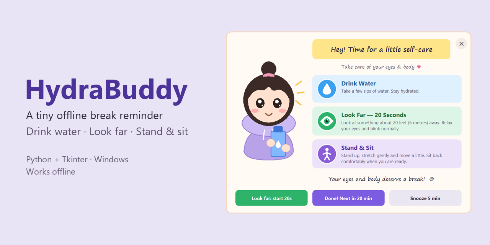
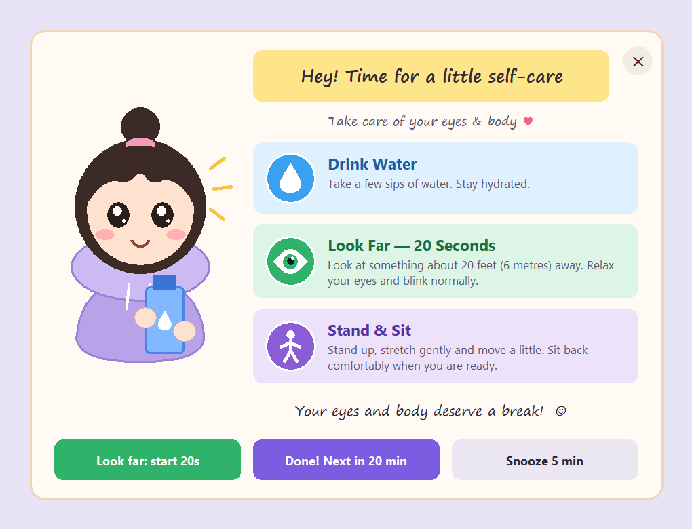
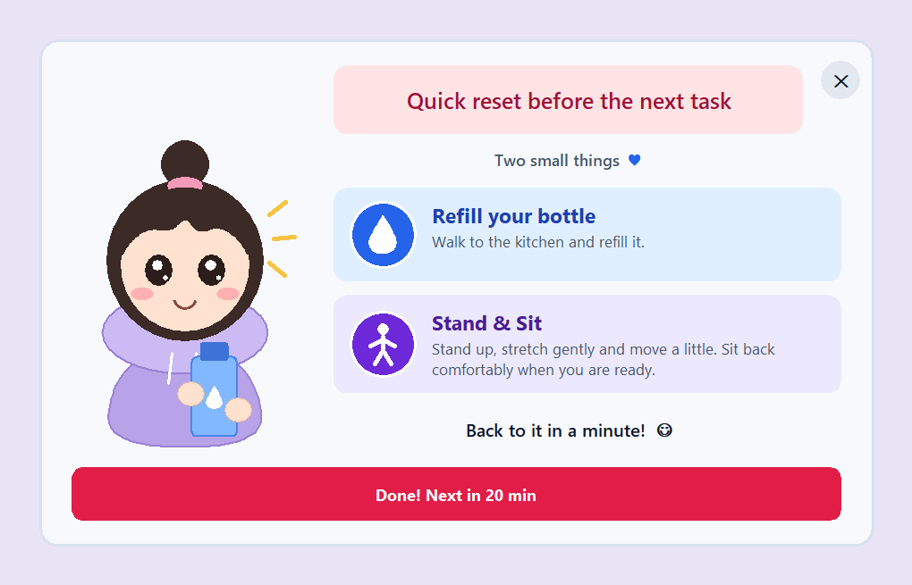
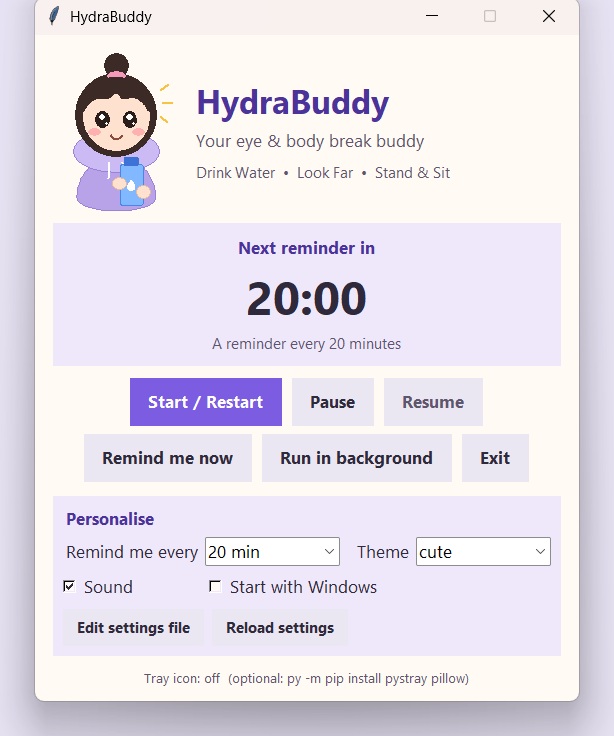
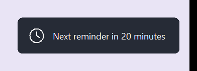

<p align="center">
  
</p>

# HydraBuddy 💧

**A small offline desktop reminder for Windows.** Every 20 minutes (or whatever interval you choose), a friendly pop-up reminds you to **drink water**, **look away from your screen**, and **stand up and move a little**.

It is one Python file, it needs no internet, and you can make it look and sound the way you like.

<p align="center">
  
</p>

---

## Why I made it

I spend long stretches studying and coding on my laptop, and I kept forgetting to drink water, rest my eyes, or get up. I didn't want another online service or account, just a small reminder that fits my own routine. So I built one.

The point isn't to build something complicated. It's to notice a small everyday problem, work out what you actually need, and make a tool that fits you.

> HydraBuddy is a habit reminder, not a medical tool. It doesn't prevent or treat eye strain or any other condition. If you have ongoing eye discomfort, blurred vision or headaches, please see an optician or doctor.

## Features

- ⏰ **Reminders on a timer:** every 10, 15, 20, 30, 45 or 60 minutes, or any value from 1 to 240 minutes in `settings.json`.
- 🪟 **Pop-up in the centre of the screen** that stays on top of other apps until you respond.
- 👀 **20-second "look far" countdown** button (the length is adjustable).
- 😴 **Snooze** (default 5 minutes), which you can switch off.
- 🔔 **Gentle chime.** It is generated in code, follows your laptop volume, and can be switched off or replaced with your own `.wav` file.
- 🎨 **4 themes:** `cute`, `minimal`, `dark`, `productivity`. You can also set any colour yourself.
- ✏️ **Your own words:** heading, sub-heading, closing message, and the title and text of each reminder.
- 🧸 **Your own mascot:** use the built-in drawn character, your own PNG/GIF picture, or no mascot.
- ✅ **Switch reminders on or off individually.**
- ⏸️ **Pause / Resume / Restart**, plus "Remind me now".
- 🔒 **Respects when you're away:** no pop-ups on the lock screen, and the countdown restarts when you unlock or wake the laptop.
- 🚀 **Start with Windows** checkbox: starts at sign-in, and comes back after unlocking if it was closed.
- 🩺 **Self-healing:** if the window ever freezes, the problem is written to the log and HydraBuddy restarts itself.
- 📌 **Optional tray icon** with a right-click menu (needs two optional packages).
- 📴 **100% offline:** no network code, no accounts, no data collection.

| Themes (real screenshots) | Personalised example |
|---|---|
|  |  |

<details>
<summary>More screenshots</summary>

| Main window | Eye countdown running | After "Done" |
|---|---|---|
|  |  |  |

</details>

---

## Install and run (Windows)

**1. Check Python.** Open **PowerShell** and run:

```powershell
py --version
```

You need Python 3 with Tkinter. The standard python.org installer includes Tkinter. HydraBuddy was developed and tested with Python 3.14 on Windows 11. If the command isn't found, install Python from [python.org](https://www.python.org/downloads/windows/) and tick **"Add python.exe to PATH"**.

**2. Download HydraBuddy.** Either click **Code → Download ZIP** on GitHub and unzip it, or use git:

```powershell
git clone https://github.com/SreyaThota/HydraBuddy.git
cd HydraBuddy
```

**3. Run it:**

```powershell
py hydra_buddy.py
```

That's it: nothing to install. You can also double-click **`run_hydrabuddy.bat`**, which starts it without a console window.

**4. (Optional) Tray icon:**

```powershell
py -m pip install -r requirements-optional.txt
```

Without this, closing the window minimises HydraBuddy to the taskbar, and everything else works the same.

### Try it without waiting 20 minutes

```powershell
py hydra_buddy.py --test
```

Test mode reminds you every **30 seconds** (snooze is 10 seconds) and doesn't change your saved settings. Close it and run it without `--test` to go back to normal. You can also click **Remind me now** in the main window.

### Start automatically with Windows

Tick **Start with Windows** in the main window (or run `py hydra_buddy.py --install-startup`). This creates two Windows **scheduled tasks** for your user:

- **HydraBuddy** starts it quietly in the background when you sign in.
- **HydraBuddy-KeepAlive** starts it again whenever you **unlock** the laptop (also after sleep), and checks every 15 minutes. That way it comes back if Windows closed it. If it's already running, nothing happens.

Clicking **Exit** keeps HydraBuddy closed until your next sign-in. To pause reminders for a while, use **Pause** instead. Untick **Start with Windows** to remove both tasks.

> Why scheduled tasks and not the Startup folder? Most of the time you wake the laptop from sleep instead of signing in, and the Startup folder only runs at sign-in.

> The tasks point to the folder HydraBuddy is in. If you move the folder, untick and re-tick the box.

---

## Personalise it

Most things can be changed in the **Personalise** section of the main window: the interval, the theme, sound, and starting with Windows. For everything else, click **Edit settings file**, change `settings.json` in Notepad, save, and click **Reload settings**.

`settings.json` only needs the values you want to change. The full list with default values is in [`settings.example.json`](settings.example.json). For example:

```json
{
  "interval_minutes": 30,
  "theme": "dark",
  "heading": "Pause, breathe, sip",
  "sound_volume": 0.4,
  "reminders": {
    "move": { "enabled": false },
    "water": { "title": "Tea time?", "text": "A warm drink counts too." }
  },
  "colors": { "primary": "#e11d48", "pill": "#ffe4e6" }
}
```

| Setting | What it does | Default |
|---|---|---|
| `interval_minutes` | Minutes between reminders (1–240) | `20` |
| `snooze_enabled` / `snooze_minutes` | Show the Snooze button / how long it waits (1–60) | `true` / `5` |
| `eye_break_seconds` | Length of the "look far" countdown (5–120) | `20` |
| `sound_enabled` / `sound_volume` | Chime on/off / loudness relative to your laptop volume (0.0–1.0) | `true` / `0.6` |
| `theme` | `cute`, `minimal`, `dark` or `productivity` | `"cute"` |
| `show_mascot` | Show the character | `true` |
| `mascot_image` | Your own PNG/GIF, e.g. `"my_mascot.png"` in the HydraBuddy folder | `""` (drawn girl) |
| `heading`, `subheading`, `closing_message` | Texts on the pop-up (`""` hides the sub-heading or closing message) | see example file |
| `reminders` → `water` / `look_far` / `move` | `enabled`, `title`, `text` for each card. `{seconds}` is replaced by `eye_break_seconds` | all on |
| `colors` | Override any theme colour, e.g. `primary`, `bg`, `pill`, `water_bg` | `{}` |

**Mistakes are safe.** If `settings.json` contains an error, such as a typo or a value out of range, HydraBuddy uses the default for that value and shows a message explaining what was wrong. It never refuses to start.

**More ways to make it yours:**
- **Sound:** put any `.wav` file named `reminder.wav` in the folder.
- **New theme:** copy one of the entries in `THEMES` near the top of `hydra_buddy.py`, give it a new name, and change the colours. It then appears in the Theme drop-down.
- **The drawn mascot:** `draw_mascot()` in `hydra_buddy.py` draws her from simple shapes, so you can change her colours there.

---

## How it works

HydraBuddy is a single Python file using only the **standard library**. The interface is built with **Tkinter**. A few Windows features are used directly through `ctypes`, and the sound uses `winsound`.

```
              ┌───────────────────────── HydraBuddyApp (Tkinter main loop) ─────────────────────────┐
settings.json │  _tick_loop() every 0.5 s ──► ReminderTimer.check_due() ──► ReminderPopup + chime   │
 ──load/check─►  (skips while locked,          (running / paused /        (Done / Snooze / X      │
              │   restarts after wake/unlock)   waiting)                    restart the timer)      │
              │  Main window: status + Personalise controls       TrayIcon thread ──post()──► queue │
              └──────────────────────────────────────────────────────────────────────────────────────┘
```

- **Timer:** `ReminderTimer` stores a *deadline* (`time.monotonic()` + interval) rather than counting down with sleeps. A Tkinter `after()` loop checks it twice a second, which uses almost no CPU and never freezes the window.
- **Pop-up:** a borderless `Toplevel` window with `-topmost`, drawn on a `Canvas`. One colour is made transparent, which gives the rounded corners. It doesn't steal keyboard focus.
- **Background:** closing the main window only hides it, and the timer keeps running. A named Windows mutex stops a second copy from starting.
- **Away detection:** if Windows won't let the app open the input desktop, the screen is locked. A gap of more than 60 seconds between timer checks means the laptop was asleep.
- **Tray (optional):** `pystray` runs in its own thread. Menu clicks are put on a queue and run by the Tkinter thread, because Tkinter isn't thread-safe.

For a guided, function-by-function walkthrough, see **[docs/LEARNING_GUIDE.md](docs/LEARNING_GUIDE.md)**.

### Project structure

```
HydraBuddy/
├── hydra_buddy.py            # the whole app
├── test_hydra_buddy.py       # 55 automated tests (unittest)
├── settings.example.json     # every setting with its default value
├── run_hydrabuddy.bat        # double-click launcher (no console window)
├── requirements-optional.txt # pystray + pillow, only for the tray icon
├── LICENSE                   # MIT
├── tools/
│   └── capture_screenshots.py  # re-creates the images in docs/images from the real app
└── docs/
    ├── LEARNING_GUIDE.md     # how the code works + interview questions
    └── images/               # screenshots, themes GIF, banner
```

Files created while you use the app (`settings.json`, `hydra_buddy.log`, `reminder.wav`) stay on your computer and are listed in `.gitignore`.

## Tests

```powershell
py -m unittest -v test_hydra_buddy.py
```

There are 55 tests, covering the timer, pause/resume, snooze, dismiss, the lock and sleep behaviour, settings validation, every theme, custom texts and images, small screens, the start-up tasks, the freeze watchdog, and the sound generation. Most tests use a fake clock, so "20 minutes" passes instantly. The tests use a temporary folder and never change your real settings. The start-up test creates scheduled tasks under a throwaway name and always deletes them.

### What has been tested, and how

| How | What |
|---|---|
| **Automated tests** (55, all passing) | Timer logic, every button's effect on the timer, no duplicate pop-ups, settings loading/validation/saving, all 4 themes, custom texts/colours/images, small-screen fitting, start-up tasks (triggers, no time limit, battery), "Exit stays closed until sign-in", freeze detection vs sleep, closing on Windows shutdown, chime generation. Locking and sleep are **simulated** in these tests. |
| **Real runs on the author's laptop** (Windows 11, Python 3.14) | A fresh clone runs and the pop-up appears after 30 s in `--test` mode. `run_hydrabuddy.bat` starts it without a console. The scheduled task starts it in the background, and a second trigger while it's running does nothing. A deliberately frozen copy was detected, logged and restarted by the watchdog. The tray icon starts. Windows played the chime. |
| **Not tested yet** | A real sign-in after a restart, a real lock/unlock and sleep/wake cycle, Windows 10, multiple monitors, Python versions other than 3.14. |

## How I built it (and how Claude Code helped)

I built HydraBuddy with **[Claude Code](https://claude.com/claude-code)**, an AI coding assistant. I described what I wanted: an offline Python/Tkinter app, three specific reminders, a cute character, background running, starting with Windows, sound, and personalisation. Claude Code wrote most of the code and the tests and explained the choices. I ran the app on my own laptop, reported what didn't work for me, and asked for changes. For example, I reported that I couldn't hear the sound; we traced it to Windows sending audio to an external HDMI display. I also asked for the pop-up to start counting only once I'm back at my laptop.

Because I don't want to publish code I can't explain, the [learning guide](docs/LEARNING_GUIDE.md) walks through every part of the app in plain English.

## Known limitations

- **Windows only.** Lock detection, the single-instance check, the start-up tasks and the sound all use Windows features. The core timer and pop-up are plain Tkinter, but it hasn't been tested on macOS or Linux.
- The pop-up appears on the **main monitor** only.
- **Full-screen games or videos** can cover the pop-up.
- The pop-up doesn't take keyboard focus (by design), so keyboard shortcuts (`Enter` = Done, `Esc` = close) only work after clicking it. The canvas-drawn pop-up isn't readable by screen readers.
- If Windows sends sound to a monitor without speakers, you won't hear the chime. Choose your speakers from the volume icon in the taskbar.
- The start-up tasks store the folder's location, so re-tick **Start with Windows** if you move the folder.

## Troubleshooting

| Problem | Fix |
|---|---|
| `py` is not recognised | Install Python from python.org with "Add to PATH", then open a **new** PowerShell window. |
| `No module named tkinter` | Run the Python installer again → *Modify* → tick **tcl/tk and IDLE**. |
| "HydraBuddy is already running" | It's already open. Check the tray (click the `^` near the clock) or the taskbar. |
| No sound | Check the volume and the output device (speaker icon → **>** → choose your speakers). Check that `"sound_enabled": true` is set. |
| My settings don't apply | Save the file in Notepad, then click **Reload settings**. A message will say if something in the file was wrong. |
| It didn't start after I opened my laptop | Check that **Start with Windows** is ticked. If you clicked **Exit** earlier, it stays closed until you next sign in. Start it by hand (or sign out and in) to bring it back. |
| Something else went wrong | Look in `hydra_buddy.log` in the HydraBuddy folder. It records every start and stop, and what the app was doing if it ever froze. |

## Uninstall

1. Untick **Start with Windows** (or run `py hydra_buddy.py --remove-startup`).
2. Click **Exit**.
3. Delete the folder.
4. Optionally run `py -m pip uninstall pystray pillow`.

## License

[MIT](LICENSE) © 2026 Sreya Thota. You're free to use, change and share HydraBuddy. Please keep the copyright notice.
